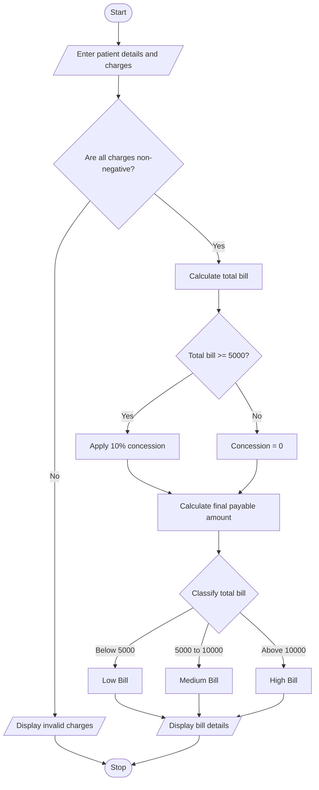

# 1. Problem Statement
Develop a Python program to calculate a patient's hospital bill by considering consultation charges, diagnostic charges, and treatment charges. Apply concessions based on specified conditions, validate billing constraints, and classify the patient according to the payment policy. Finally, display the total bill, concession amount, final payable amount, and patient classification.
# 2. Algorithm
1. Start the program.
2. Read the patient's name and patient type.
3. Enter consultation, diagnostic, and treatment charges.
4. Validate that all charges are non-negative.
5. Calculate the total bill by adding all charges.
6. Apply a 10% concession if the total bill is ₹5,000 or more.
7. Calculate the final payable amount after concession.
8. Classify the patient:
   - Low Bill: Below ₹5,000
   - Medium Bill: ₹5,000 to ₹10,000
   - High Bill: Above ₹10,000
9. Display the total bill, concession, final payable amount, and classification.
10. Stop the program.
# 3 Flowchart (Mermaid)

# 4.Source Code (Python)

# Hospital Billing and Patient Classification

name = input("Enter patient name: ")
patient_type = input("Enter patient type (General/Senior): ")

consultation = float(input("Enter consultation charges: "))
diagnostic = float(input("Enter diagnostic charges: "))
treatment = float(input("Enter treatment charges: "))

# Validate billing constraints
if min(consultation, diagnostic, treatment) < 0:
    print("Error: Charges cannot be negative.")

elif patient_type.lower() not in ["general", "senior"]:
    print("Error: Invalid patient type.")

else:
    total = consultation + diagnostic + treatment

    # Apply conditional concession
    concession = 0
    if total >= 5000:
        concession = total * 0.10

    # Senior patients receive an additional 5%
    # concession on the remaining bill.
    if patient_type.lower() == "senior":
        concession += (total - concession) * 0.05

    payable = total - concession

    # Classify using the original total bill
    if total < 5000:
        category = "Low Bill"
    elif total <= 10000:
        category = "Medium Bill"
    else:
        category = "High Bill"

    print("\n----- HOSPITAL BILL -----")
    print("Patient Name:", name)
    print("Patient Type:", patient_type)
    print(f"Consultation: Rs. {consultation:.2f}")
    print(f"Diagnostic: Rs. {diagnostic:.2f}")
    print(f"Treatment: Rs. {treatment:.2f}")
    print(f"Total Bill: Rs. {total:.2f}")
    print(f"Concession: Rs. {concession:.2f}")
    print(f"Final Payable: Rs. {payable:.2f}")
    print("Classification:", category)
# 5. Sample Input and Output
Enter patient name: Kalyan
Enter patient type (General/Senior): General
Enter consultation charges: 1000
Enter diagnostic charges: 2500
Enter treatment charges: 3000

# output
----- HOSPITAL BILL -----
Patient Name: Kalyan
Patient Type: General
Consultation: Rs. 1000.00
Diagnostic: Rs. 2500.00
Treatment: Rs. 3000.00
Total Bill: Rs. 6500.00
Concession: Rs. 650.00
Final Payable: Rs. 5850.00
Classification: Medium Bill
# 6. Output Screenshot

