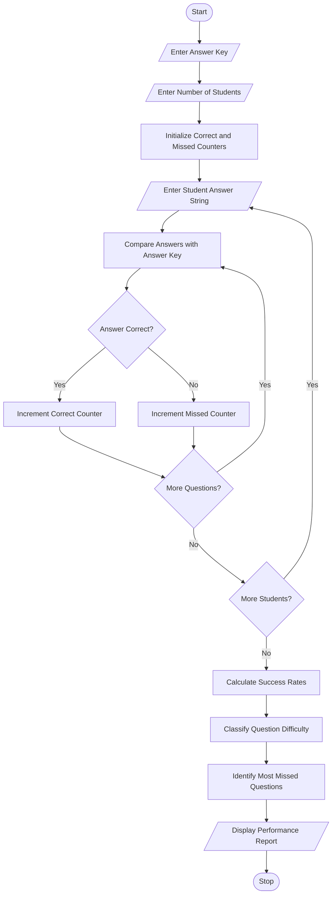

# 1. Problem Statement
Evaluating examination performance manually can be time-consuming, especially when there are many students and questions. Teachers need an efficient way to compare student answers with the correct answer key, calculate question-wise success rates, and identify difficult questions.

The Examination Question Difficulty and Performance Analysis program compares student answer strings against a predefined answer key. It calculates the number of correct and incorrect answers for each question, determines success percentages, identifies the most frequently missed questions, and classifies questions based on their difficulty.

Objectives:
1. Accept the correct answer key.
2. Accept answers from multiple students.
3. Compare each student's answer with the answer key.
4. Calculate question-wise correct and incorrect responses.
5. Calculate question-wise success rates.
6. Identify the most frequently missed questions.
7. Classify questions as Easy, Moderate, or Difficult.
# 2. Algorithm
1. Start the program.
2. Read the correct answer key.
3. Read the number of students.
4. Initialize correct and missed answer counters for each question.
5. For every student:
   - Read the student's answer string.
   - Compare each answer with the corresponding answer key.
   - If the answer matches, increment the correct counter.
   - Otherwise, increment the missed counter.
6. Calculate the success rate for each question:
\[
SuccessRate = \frac{CorrectAnswers}{TotalStudents}\times100
\]

7. Classify question difficulty:
   - Easy: Success rate ≥ 80%.
   - Moderate: Success rate ≥ 50% and less than 80%.
   - Difficult: Success rate less than 50%.
8. Identify the question or questions with the highest missed count.
9. Display the question-wise performance report.
10. Stop.
# 3. Flowchart (Mermaid)

# 4. Source Code (Python)
   
def main():
    print("=" * 60)
    print("EXAMINATION QUESTION PERFORMANCE ANALYSIS")
    print("=" * 60)

    key = input("Enter answer key (example: ABCD): ").strip().upper()

    if not key:
        print("Answer key cannot be empty.")
        return

    students = int(input("Enter number of students: "))

    if students <= 0:
        print("Student count must be greater than zero.")
        return

    n = len(key)

    correct = [0] * n
    missed = [0] * n

    for student in range(students):

        while True:
            answers = input(
                f"Enter answers for student {student + 1}: "
            ).strip().upper()

            if len(answers) == n:
                break

            print(f"Please enter exactly {n} answers.")

        for q in range(n):

            if answers[q] == key[q]:
                correct[q] += 1
            else:
                missed[q] += 1

    print("\nQUESTION-WISE PERFORMANCE")
    print("-" * 60)

    print(f"{'Question':<12}{'Correct':>10}"
          f"{'Missed':>10}{'Success %':>12}{'Class':>14}")

    for q in range(n):

        rate = (correct[q] / students) * 100

        if rate >= 80:
            category = "Easy"
        elif rate >= 50:
            category = "Moderate"
        else:
            category = "Difficult"

        print(f"{'Q' + str(q+1):<12}{correct[q]:>10}"
              f"{missed[q]:>10}{rate:>11.1f}%"
              f"{category:>14}")

    highest = max(missed)

    difficult_questions = [
        f"Q{i+1}" for i in range(n)
        if missed[i] == highest
    ]

    print("-" * 60)
    print("Most frequently missed questions:",
          ", ".join(difficult_questions))

    print("Number of students missing each:", highest)

    print("\nDIFFICULTY CLASSIFICATION")
    print("Easy: Success rate >= 80%")
    print("Moderate: Success rate >= 50% and < 80%")
    print("Difficult: Success rate < 50%")

if __name__ == "__main__":
    main()
# 5. Sample Input
ABCD

Student answers:
Student	Answer string
Student 1	ABCD
Student 2	ABCD
Student 3	ABBD
Student 4	ACCD
Student 5	BBCD
Student 6	ABBA
# 6. Sample Output
============================================================
EXAMINATION QUESTION PERFORMANCE ANALYSIS
============================================================

QUESTION-WISE PERFORMANCE

Question       Correct    Missed     Success %         Class
------------------------------------------------------------
Q1                  5         1         83.3%          Easy
Q2                  5         1         83.3%          Easy
Q3                  4         2         66.7%      Moderate
Q4                  4         2         66.7%      Moderate
------------------------------------------------------------

Most frequently missed questions: Q3, Q4
Number of students missing each: 2

DIFFICULTY CLASSIFICATION
Easy: Success rate >= 80%
Moderate: Success rate >= 50% and < 80%
Difficult: Success rate < 50%
# 7. Program Screenshot

