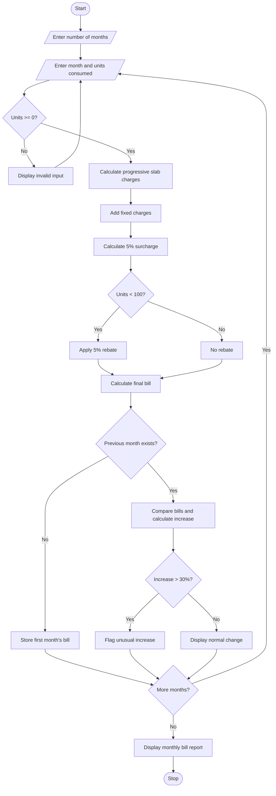

# 1. Problem Statement
Develop a Python program to calculate household electricity bills using progressive consumption slabs. The program should accept electricity consumption for multiple months, calculate charges based on different slab rates, add fixed charges and surcharges, apply eligible rebates, and display the final bill for each month. It should also compare monthly bills and identify unusual increases in electricity charges.
# 2. Algorithm
1. Start the program.
2. Read the number of months to analyze.
3. For each month, input the month name and electricity units consumed.
4. Validate that the units consumed are not negative.
5. Calculate energy charges using progressive slabs:
   - First 100 units: ₹1.50 per unit.
   - Next 100 units: ₹2.50 per unit.
   - Above 200 units: ₹4.00 per unit.
6. Add fixed charges of ₹50.
7. Calculate a surcharge of 5% on energy charges.
8. Apply a 5% rebate on the subtotal if consumption is below 100 units.
9. Calculate the final bill.
10. Compare each month's bill with the previous month's bill.
11. If the bill increases by more than 30%, identify it as an unusual increase.
12. Display the monthly bill details and comparison results.
13. Stop the program.
# 3. Flowchart (Mermaid)

# 4. Source Code (Python)

# Progressive Electricity Billing System

months = int(input("Enter number of months: "))

previous_bill = None

for i in range(months):
    print("\nMonth", i + 1)
    month = input("Enter month name: ")
    units = float(input("Enter units consumed: "))

    if units < 0:
        print("Invalid units! Enter again.")
        continue

    # Calculate progressive energy charges
    if units <= 100:
        energy = units * 1.50
    elif units <= 200:
        energy = (100 * 1.50) + ((units - 100) * 2.50)
    else:
        energy = (100 * 1.50) + (100 * 2.50) \
                 + ((units - 200) * 4.00)

    fixed_charge = 50
    surcharge = energy * 0.05
    subtotal = energy + fixed_charge + surcharge

    # Apply rebate for low consumption
    rebate = subtotal * 0.05 if units < 100 else 0
    bill = subtotal - rebate

    print("\n--- Electricity Bill ---")
    print("Month:", month)
    print("Units Consumed:", units)
    print("Energy Charges: Rs.", round(energy, 2))
    print("Fixed Charges: Rs.", round(fixed_charge, 2))
    print("Surcharge: Rs.", round(surcharge, 2))
    print("Rebate: Rs.", round(rebate, 2))
    print("Final Bill: Rs.", round(bill, 2))

    # Compare with previous month's bill
    if previous_bill is not None:
        increase = bill - previous_bill

        if previous_bill > 0:
            percentage = (increase / previous_bill) * 100
            print("Bill Change: Rs.", round(increase, 2))
            print("Percentage Change:",
                  round(percentage, 2), "%")

            if percentage > 30:
                print("Warning: Unusual bill increase!")
            else:
                print("No unusual increase detected.")
        else:
            print("Previous bill is zero; percentage "
                  "comparison is unavailable.")

    previous_bill = bill

print("\nBilling analysis completed.")
# 5. Sample Input
Enter number of months: 3

Month 1
Enter month name: January
Enter units consumed: 80

Month 2
Enter month name: February
Enter units consumed: 120

Month 3
Enter month name: March
Enter units consumed: 250
# 6. Sample Output
--- Electricity Bill ---
Month: January
Units Consumed: 80.0
Energy Charges: Rs. 120.0
Fixed Charges: Rs. 50
Surcharge: Rs. 6.0
Rebate: Rs. 8.8
Final Bill: Rs. 167.2

--- Electricity Bill ---
Month: February
Units Consumed: 120.0
Energy Charges: Rs. 200.0
Fixed Charges: Rs. 50
Surcharge: Rs. 10.0
Rebate: Rs. 0
Final Bill: Rs. 260.0
Bill Change: Rs. 92.8
Percentage Change: 55.5 %
Warning: Unusual bill increase!

--- Electricity Bill ---
Month: March
Units Consumed: 250.0
Energy Charges: Rs. 600.0
Fixed Charges: Rs. 50
Surcharge: Rs. 30.0
Rebate: Rs. 0
Final Bill: Rs. 680.0
Bill Change: Rs. 420.0
Percentage Change: 161.54 %
Warning: Unusual bill increase!

Billing analysis completed.
# 7. Screenshot 

