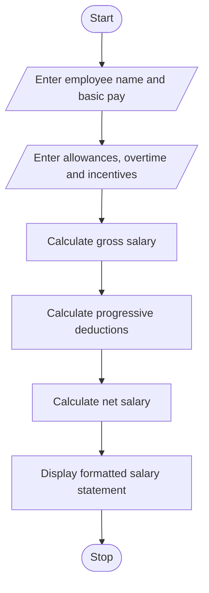

# 1. Problem Statement
Develop a Python program to calculate an employee's salary by accepting basic pay, allowances, overtime pay, and incentives. Calculate the gross salary, apply progressive deductions based on salary slabs, and generate a formatted salary statement showing gross salary, total deductions, and net salary.
# 2. Algorithm
1. Start the program.
2. Read the employee's name and basic pay.
3. Read allowances, overtime pay, and incentives.
4. Calculate gross salary:
Gross Salary = Basic Pay + Allowances + Overtime + Incentives
5. Calculate progressive deductions using the following sample policy:
- First ₹10,000: 0% deduction.
- Next ₹10,000: 5% deduction.
- Remaining amount above ₹20,000: 10% deduction.
6. Calculate net salary:

Net Salary = Gross Salary − Total Deductions
7. Display the formatted salary statement.
8. Stop the program.
# 3. Flowchart (Mermaid)

# 4. Source Code (Python)
   
# Employee Payroll and Deduction Analysis

name = input("Enter employee name: ")
basic = float(input("Enter basic pay: "))
allowances = float(input("Enter allowances: "))
overtime = float(input("Enter overtime pay: "))
incentives = float(input("Enter incentives: "))

if min(basic, allowances, overtime, incentives) < 0:
    print("Error: Salary amounts cannot be negative.")
else:
    gross = basic + allowances + overtime + incentives

    # Progressive deduction calculation
    if gross <= 10000:
        deduction = 0
    elif gross <= 20000:
        deduction = (gross - 10000) * 0.05
    else:
        deduction = 10000 * 0.05 + (gross - 20000) * 0.10

    net = gross - deduction

    print("\n========== SALARY STATEMENT ==========")
    print("Employee Name   :", name)
    print(f"Basic Pay       : Rs. {basic:,.2f}")
    print(f"Allowances      : Rs. {allowances:,.2f}")
    print(f"Overtime Pay    : Rs. {overtime:,.2f}")
    print(f"Incentives      : Rs. {incentives:,.2f}")
    print("--------------------------------------")
    print(f"Gross Salary    : Rs. {gross:,.2f}")
    print(f"Total Deductions: Rs. {deduction:,.2f}")
    print(f"Net Salary      : Rs. {net:,.2f}")
    print("======================================")
# 5. Sample Input
Enter employee name: Kalyan
Enter basic pay: 25000
Enter allowances: 5000
Enter overtime pay: 2000
Enter incentives: 1000
# 6. Sample Output
========== SALARY STATEMENT ==========
Employee Name   : Kalyan
Basic Pay       : Rs. 25,000.00
Allowances      : Rs. 5,000.00
Overtime Pay    : Rs. 2,000.00
Incentives      : Rs. 1,000.00
--------------------------------------
Gross Salary    : Rs. 33,000.00
Total Deductions: Rs. 1,800.00
Net Salary      : Rs. 31,200.00
======================================
# 7. Screenshot of Output

