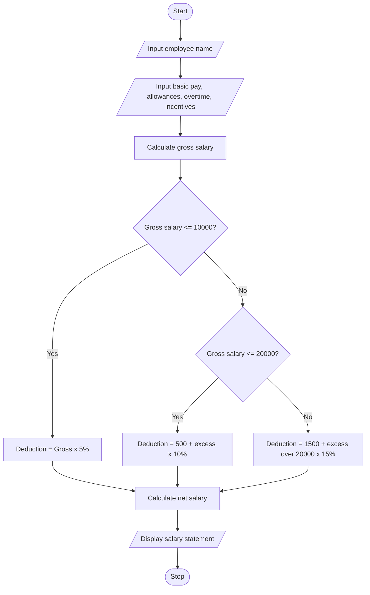

# 1. Problem Statement
Develop a Python program to calculate an employee's salary by accepting basic pay, allowances, overtime pay, and incentives. Calculate the gross salary, apply progressive deductions based on salary slabs, and generate a formatted salary statement showing gross salary, total deductions, and net salary.
# 2. Algorithm
1. Start the program.
2. Read the employee's name and basic pay.
3. Read allowances, overtime pay, and incentives.
4. Calculate gross salary by adding all earnings.
5. Calculate progressive deductions using the following sample slabs:
   - First ₹10,000: 5%
   - Next ₹10,000: 10%
   - Amount above ₹20,000: 15%
6. Calculate total deductions.
7. Calculate net salary using Net Salary = Gross Salary − Total Deductions.
8. Display the formatted salary statement.
9. Stop the program.# 
# 3. Flowchart (Mermaid)

# 4. Source Code (Python)
   
print("===== EMPLOYEE PAYROLL ANALYSIS =====")

name = input("Enter employee name: ")
basic = float(input("Enter basic pay: "))
allowances = float(input("Enter allowances: "))
overtime = float(input("Enter overtime pay: "))
incentives = float(input("Enter incentives: "))

# Calculate gross salary
gross = basic + allowances + overtime + incentives

# Calculate progressive deductions
if gross <= 10000:
    deduction = gross * 0.05
elif gross <= 20000:
    deduction = 500 + (gross - 10000) * 0.10
else:
    deduction = 1500 + (gross - 20000) * 0.15

# Calculate net salary
net = gross - deduction

# Display salary statement
print("\n===== SALARY STATEMENT =====")
print("Employee Name    :", name)
print("Basic Pay        : Rs.", basic)
print("Allowances       : Rs.", allowances)
print("Overtime Pay     : Rs.", overtime)
print("Incentives       : Rs.", incentives)
print("----------------------------")
print("Gross Salary     : Rs.", gross)
print("Total Deductions : Rs.", deduction)
print("Net Salary       : Rs.", net)
# 5. Sample Input
Input field                	Value
Employee name             	Kalyan
Basic pay                 	₹15,000
Allowances	                 ₹3,000
Overtime pay	              ₹1,000
Incentives	               ₹2,000
# 6. Sample Output
Employee Name    : Kalyan
Basic Pay        : Rs. 15000.0
Allowances       : Rs. 3000.0
Overtime Pay     : Rs. 1000.0
Incentives       : Rs. 2000.0
----------------------------
Gross Salary     : Rs. 21000.0
Total Deductions : Rs. 1650.0
Net Salary       : Rs. 19350.0
# 7. Screenshot

