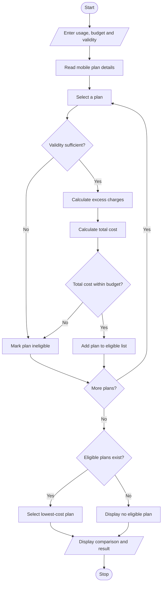

# 1. Problem Statement
Develop a Python program to evaluate multiple mobile recharge plans based on data usage, call minutes, validity, and budget constraints. Calculate the total cost of each plan, including excess usage charges. Identify and display the most economical plan that satisfies all user requirements. If no plan meets the constraints, display a suitable message.
# 2. Algorithm
1. Start the program.
2. Read the user's data usage, call minutes, required validity, and budget.
3. Define the available mobile plans with their prices, data limits, call limits, validity, and excess charges.
4. Calculate the excess data and excess call charges for each plan.
5. Calculate the total cost of each plan.
6. Check whether each plan satisfies the usage, validity, and budget constraints.
7. Compare the costs of all eligible plans.
8. Display the most economical eligible plan and its total cost.
9. If no plan is eligible, display an appropriate message.
10. Stop the program.

# 3. Flowchart (Mermaid)

# 4. Source Code (Python)

# Multi-Plan Telecommunications Cost Optimization

plans = [
    {"name": "Starter", "price": 199, "data": 2,
     "calls": 100, "validity": 28,
     "data_rate": 50, "call_rate": 0.50},

    {"name": "Smart", "price": 249, "data": 3,
     "calls": 300, "validity": 28,
     "data_rate": 40, "call_rate": 0.40},

    {"name": "Value", "price": 299, "data": 5,
     "calls": 500, "validity": 56,
     "data_rate": 30, "call_rate": 0.30},

    {"name": "Mini", "price": 149, "data": 1,
     "calls": 100, "validity": 14,
     "data_rate": 60, "call_rate": 0.60}
]

usage_data = float(input("Enter data usage (GB): "))
usage_calls = int(input("Enter call minutes: "))
required_days = int(input("Enter required validity (days): "))
budget = float(input("Enter budget (Rs.): "))

eligible = []

print("\n--- MOBILE PLAN COMPARISON ---")
print(f"{'Plan':<10}{'Total Cost':>12}  Status")
print("-" * 38)

for plan in plans:
    extra_data = max(0, usage_data - plan["data"])
    extra_calls = max(0, usage_calls - plan["calls"])

    data_charge = extra_data * plan["data_rate"]
    call_charge = extra_calls * plan["call_rate"]
    total = plan["price"] + data_charge + call_charge

    if plan["validity"] >= required_days and total <= budget:
        status = "Eligible"
        eligible.append((total, plan["name"]))
    else:
        status = "Not eligible"

    print(f"{plan['name']:<10}{total:>12.2f}  {status}")

if eligible:
    best_cost, best_name = min(eligible)
    print("\nMost economical eligible plan:", best_name)
    print(f"Total cost: Rs. {best_cost:.2f}")
else:
    print("\nNo plan satisfies the budget and validity constraints.")
# 5. Sample Input
Enter data usage (GB): 2.5
Enter call minutes: 200
Enter required validity (days): 28
Enter budget (Rs.): 350
# 6. Sample Output

Starter       274.00  Eligible
Smart         249.00  Eligible
Value         299.00  Eligible
Mini          299.00  Not eligible

Most economical eligible plan: Smart
Total cost: Rs. 249.00
# 7. Screenshot

