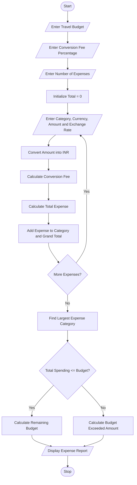

# 1. Problem Statement
Travelers often spend money in different currencies while visiting multiple countries. It becomes difficult to calculate the total travel expenses, account for currency exchange rates and conversion fees, and compare the total spending with the planned budget.

The Multi-Currency Travel Budget Analysis program calculates travel expenses by converting different currencies into a common base currency using supplied exchange rates. It also incorporates currency conversion fees, compares the total expenses against the allocated budget, and identifies the largest expense category.

Objectives:
1. Accept travel expenses in multiple currencies.
2. Convert expenses into the base currency (INR).
3. Apply currency conversion fees.
4. Calculate the total travel expenditure.
5. Compare total spending with the allocated budget.
6. Display the remaining budget or excess amount.
7. Identify the largest expense category.
# 2. Algorithm
1. Start the program.
2. Read the travel budget in INR.
3. Read the currency conversion fee percentage.
4. Enter the number of travel expenses.
5. For each expense, input:
   - Expense category.
   - Currency code.
   - Amount spent.
   - Exchange rate (INR per one unit of foreign currency).
6. Calculate the converted amount:
\[
Converted = Amount \times ExchangeRate
\]

7. Calculate the conversion fee:
\[
Fee = Converted \times \frac{FeeRate}{100}
\]

8. Calculate the total expense:
\[
Total = Converted + Fee
\]

9. Add all expenses to calculate total spending.
10. Compare total spending with the allocated budget.
11. Identify the category with the highest total expense.
12. Display the expense report, total spending, budget status, and largest expense category.
13. Stop.
# 3. Flowchart (Mermaid)

# 4. Source Code (Python)
   
def main():
    print("=" * 58)
    print("MULTI-CURRENCY TRAVEL BUDGET ANALYSIS")
    print("=" * 58)

    budget = float(input("Enter travel budget (INR): "))
    fee_rate = float(input("Enter conversion fee percentage: "))
    count = int(input("Enter number of expenses: "))

    total_spending = 0.0
    category_totals = {}
    expense_rows = []

    for i in range(count):
        print(f"\nExpense {i + 1}")

        category = input("Enter category: ").strip().title()
        currency = input("Enter currency code: ").strip().upper()
        amount = float(input(f"Enter amount in {currency}: "))
        rate = float(input("Enter exchange rate (INR per 1 unit): "))

        converted = amount * rate
        fee = converted * fee_rate / 100
        total = converted + fee

        category_totals[category] = (
            category_totals.get(category, 0) + total
        )

        total_spending += total
        expense_rows.append(
            (category, currency, amount, converted, fee, total)
        )

    largest_category = (
        max(category_totals, key=category_totals.get)
        if category_totals else "N/A"
    )

    print("\n" + "=" * 86)
    print("TRAVEL EXPENSE REPORT")
    print("=" * 86)

    print(f"{'Category':<16}{'Currency':<10}{'Amount':>12}"
          f"{'Converted':>14}{'Fee':>12}{'Total INR':>14}")

    print("-" * 86)

    for category, currency, amount, converted, fee, total in expense_rows:
        print(f"{category:<16}{currency:<10}{amount:>12.2f}"
              f"{converted:>14.2f}{fee:>12.2f}{total:>14.2f}")

    print("-" * 86)
    print(f"Total spending (INR):       {total_spending:,.2f}")
    print(f"Allocated budget (INR):     {budget:,.2f}")

    if total_spending <= budget:
        print(f"Remaining budget (INR):     {budget-total_spending:,.2f}")
        print("Budget status:              WITHIN BUDGET")
    else:
        print(f"Budget exceeded (INR):      {total_spending-budget:,.2f}")
        print("Budget status:              OVER BUDGET")

    print(f"Largest expense category:   {largest_category}")
    print(f"Amount in that category:    INR "
          f"{category_totals.get(largest_category, 0):,.2f}")

    print("=" * 86)

if __name__ == "__main__":
    main()
# 5. Sample Input
Input	Value
Travel budget	₹100,000
Conversion fee	2%
Number of expenses	4

Expense details:
Category	Currency	Amount	Exchange rate
Hotel	USD	400	83
Food	EUR	200	90
Transport	GBP	100	105
Shopping	USD	300	83

# 6. Sample Output
   ==========================================================
MULTI-CURRENCY TRAVEL BUDGET ANALYSIS
==========================================================

TRAVEL EXPENSE REPORT

Category        Currency      Amount     Converted
---------------------------------------------------
Hotel           USD           400.00      33200.00
Food            EUR           200.00      18000.00
Transport       GBP           100.00      10500.00
Shopping        USD           300.00      24900.00
---------------------------------------------------

Category        Conversion Fee       Total INR
Hotel                664.00          33864.00
Food                 360.00          18360.00
Transport            210.00          10710.00
Shopping             498.00          25398.00

Total spending:       INR 88,332.00
Allocated budget:     INR 100,000.00
Remaining budget:     INR 11,668.00

Budget status: WITHIN BUDGET

Largest expense category: Hotel
Amount: INR 33,864.00
==========================================================
# 7. Program Screenshot
   

